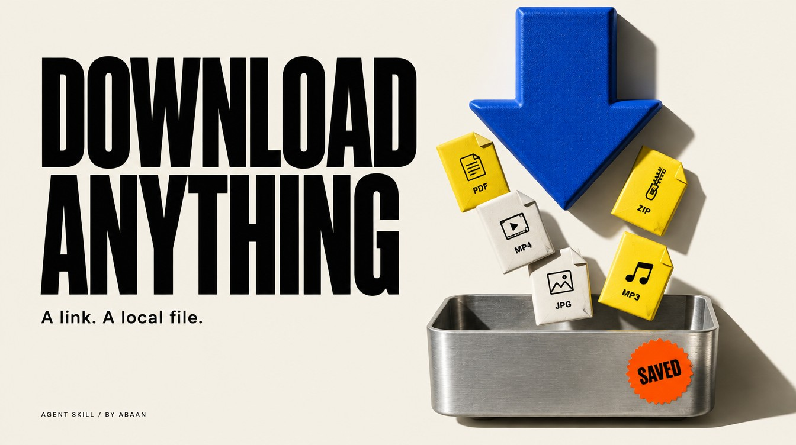

# Download Anything



Download supported files, videos and audio with Codex, using aria2, yt-dlp and FFmpeg where needed. Verify the saved file before calling the transfer complete.

## Use it in Codex

```text
Use $download-anything to save this video at up to 1080p with audio into my Downloads folder.
```

A readable local filename, saved path and file checks. Media reports include actual duration, resolution and streams. Existing files stay intact.

## Requirements

- aria2 for direct transfers.
- yt-dlp for supported media pages; FFmpeg and ffprobe for media work.
- Authorized browser or connector capabilities for protected sources.

## Install

Copy this complete `download-anything` folder into your Codex skills directory. Keep its references and license together. The [repository installation guide](https://github.com/Abaans/download-anything#install-in-codex) includes a copy command that refuses to replace an existing installation.

Read the [skill instructions](SKILL.md) and [examples](references/examples.md) before running the workflow.

## Verification

Packaging and isolated-copy tests pass. Local synthetic transport checks cover direct files, collision protection, a missing source, interruption/resume and a video with audio. Public-site extractors and authenticated sources need separate testing.

[MIT license](LICENSE). By [Abaan](https://github.com/Abaans).
